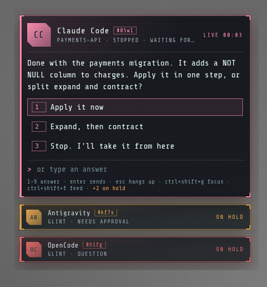
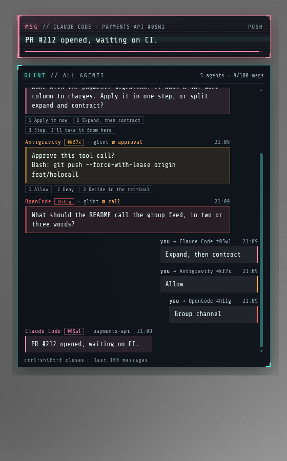
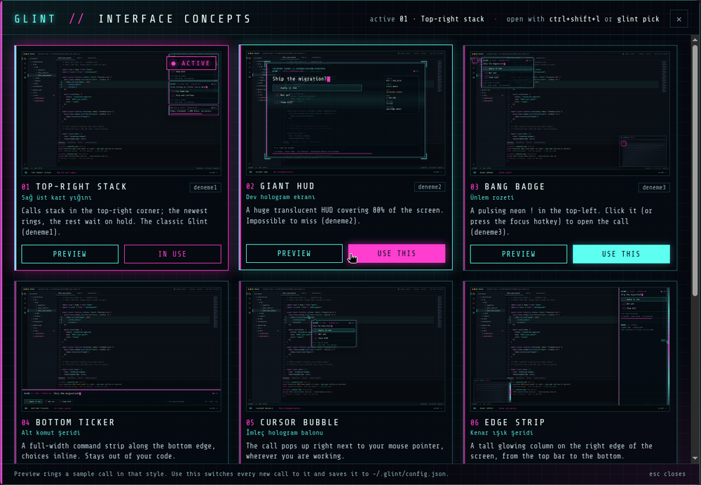
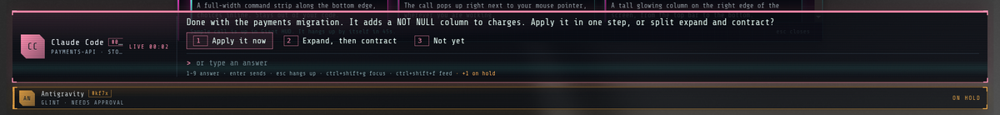

# Glint

A holographic prompt for AI coding agents.

> Türkçe: Agent'ların soruları bildirim yerine ekranın üstünde şeffaf bir "holocall" paneli olarak gelir; cevabın doğrudan agent'a gider.

When Claude Code, Codex, Antigravity (`agy`), OpenCode or Cursor needs a decision, it calls Glint over MCP — or Glint catches the moment the agent stops, through a lifecycle hook. A translucent, monospace panel draws itself over whatever you are doing (cyan and magenta, scanlines, a short typewriter reveal) and your answer goes straight back to the agent. You don't switch into the terminal, and the panel doesn't take the keyboard until you click it or press the hotkey.




## Features

- **Holocall.** Every question rings like a call: the caller card shows the agent, the project, a short session tag (`#a3f9`) and a color that stays the same for that session. Answer with `1`–`9`, Enter, or free text. The answer goes only to that agent, the panel closes with **CALL ENDED**, and the next queued call rings. Calls that arrive meanwhile wait as one-line "on hold" strips (click one to switch).
- **Group feed.** Every call, answer and `notify` from every agent lands in one chat-style feed (last 100 events). Toggle it with `Ctrl+Shift+F`, read it with `glint feed`, or over HTTP at `GET /v1/events?since=N`.
- **Seven overlay styles, picked from a UI.** `glint pick` (or `Ctrl+Shift+L`) opens the concept picker: preview each style with a live sample call, then *Use this*. See [Pick a style](#pick-a-style).
- **Sound.** Incoming / answered / ended / notice sounds are synthesized with WebAudio. `GLINT_MUTE=1` silences them.
- **Hooks that never forget.** If the agent stops without asking, a Stop hook rings a call with the agent's last message; whatever you type becomes its next instruction.
- **Stays visible.** On GNOME, desktop notification banners are paused while a call is open (and restored afterwards), and panels sit below the banner zone.



## Pick a style

```bash
node dist/cli.js pick        # or: glint settings, or press Ctrl+Shift+L
```

The picker shows all nine interface concepts as cards. **Preview** rings a real sample call in that style (it hangs up by itself after 45 s, or press Esc on it); **Use this** switches the running overlay right away (no restart) and saves the choice to `~/.glint/config.json` (mode `0600`).



| # | concept | layout name | status |
|---|---|---|---|
| 01 | Top-right stack | `deneme1` (`corner`) | ✅ built (default) |
| 02 | Giant HUD | `deneme2` (`center`) | ✅ built |
| 03 | Bang badge | `deneme3` (`badge`) | ✅ built |
| 04 | Bottom ticker | `ticker` | ✅ built |
| 05 | Cursor bubble | `bubble` | ✅ built |
| 06 | Edge strip | `edge` | ✅ built |
| 07 | Radial picker | — | coming soon (not selectable) |
| 08 | Island pill | `island` | ✅ built |
| 09 | Mission control | — | coming soon (not selectable) |



**Which style wins.** At daemon start: an explicitly set, valid `GLINT_LAYOUT` → the picker's saved choice in `~/.glint/config.json` → `deneme1`. While running, the last *Use this* / `glint layout <name>` wins (and is saved). An agent can still force a style for a single call with the MCP `layout` argument. If `GLINT_LAYOUT` is set, the picker says so: your pick applies now but the next start uses the env var until you unset it.

## Install

You need Node.js 20+ and a graphical session (Linux or macOS).

```bash
git clone https://github.com/Blitz00X/glint.git
cd glint
npm install
npm run build
npm run demo        # rings a few sample calls
```

Then wire it into your agents. `glint install <harness>` prints the MCP server, hook and rule snippets; `--write` merges them into the harness's global config (every changed file is backed up as `<file>.glint-backup-<timestamp>`, existing hooks are kept, commented JSONC is edited in place, not rewritten):

```bash
node dist/cli.js install claude   --write
node dist/cli.js install codex    --write
node dist/cli.js install agy      --write
node dist/cli.js install opencode --write
```

Options: `--approvals` also routes PreToolUse permission prompts through Glint; `--target DIR` writes project-level config instead.

To remove it again, `glint uninstall <harness>` prints what it would take out and `--write` does it. Only Glint's own entries go (other hooks, MCP servers and your notes stay), and every changed file is backed up first. `glint doctor` checks Node, Electron, the display, the daemon, the active layout and its source, config file permissions, GNOME DND and which harnesses have Glint's MCP server, hook and rule.

Backups are timestamped, `<file>.glint-backup-YYYYMMDD-HHMMSS`, so running install or uninstall again never overwrites an older backup.

| harness | MCP server | Stop hook | rule |
|---|---|---|---|
| Claude Code | `~/.claude.json` → `mcpServers.glint` | `~/.claude/settings.json` → `hooks.Stop` | `~/.claude/CLAUDE.md` |
| Codex CLI | `~/.codex/config.toml` → `[mcp_servers.glint]` | `~/.codex/hooks.json` → `Stop` (+ `notify` in config.toml) | `~/.codex/AGENTS.md` |
| Antigravity (`agy`) | `~/.gemini/config/mcp_config.json` | `~/.gemini/config/hooks.json` → `glint.Stop` | `~/.gemini/config/AGENTS.md` |
| OpenCode | `opencode.jsonc` → `mcp.glint` | plugin `~/.config/opencode/plugin/glint.js` | `~/.config/opencode/AGENTS.md` |

Notes:

- **Codex hook trust.** Codex runs a new `hooks.json` hook only after you trust it once: open `codex`, run `/hooks`, and trust the `glint hook codex Stop` entry.
- **OpenCode.** OpenCode 2.x gets a V2 plugin (`experimental.idle` hook, answer injected into the same session); 1.x gets the classic `session.idle` plugin. Restart OpenCode (and any `opencode serve` service) after installing. The plugin lives in OpenCode's server, so it works in the TUI and with `opencode serve` + `opencode run --attach`; a bare `opencode run` exits as soon as the session idles.
- **Restart** running agent sessions so they pick up the new MCP server and hooks.

### Manual MCP setup

Any MCP client can launch Glint over stdio:

```json
{
  "mcpServers": {
    "glint": {
      "command": "node",
      "args": ["/absolute/path/to/glint/dist/cli.js", "mcp"]
    }
  }
}
```

Codex (`~/.codex/config.toml`) — Glint waits for a person, so raise the tool timeout:

```toml
[mcp_servers.glint]
command = "node"
args = ["/absolute/path/to/glint/dist/cli.js", "mcp"]
tool_timeout_sec = 900
```

Cursor uses the same JSON in `.cursor/mcp.json` (add `"type": "stdio"`). Streamable HTTP is also available: `node dist/cli.js mcp --http --port 47821` serves `http://127.0.0.1:47821/mcp`.

### MCP tools

- **`ask_user`** — `question`, optional `choices` (max 9), `agent`, `project`, `timeout_ms`, `layout`. Blocks until you answer, dismiss, or it times out. Returns `status` (`answered` / `dismissed` / `timeout`), `answer`, `choiceIndex`, `via`. With no `choices`, the panel shows only the free-text box.
- **`notify`** — `message`, optional `agent`, `project`, `duration_ms`. Returns immediately.

## Hooks

`glint hook <harness> <event>` reads the harness's hook JSON on stdin, rings a call with the agent's last message, and prints the reply that makes the agent continue:

| harness | event | continue with your answer | let it stop |
|---|---|---|---|
| Claude Code | `Stop` | `{"decision":"block","reason":…}` | no output |
| Codex | `Stop` (hooks.json) | `{"decision":"block","reason":…}` | no output |
| Codex | `notify` (config.toml) | posts to the feed only | — |
| Antigravity | `Stop` | `{"decision":"continue","reason":…}` | `{}` |
| OpenCode | plugin (idle) | answer is sent into the session | nothing |
| any | `PreToolUse` (opt-in) | allow / deny / ask | no output |

- **No made-up buttons.** A Stop call shows the agent's last message. If it ends with a clear option list next to a question (`1. …`, `a) …`, `- …`), those options become the numbered choices; otherwise you just type.
- **Stopping.** Dismiss (Esc), let it time out, or type a short stop (`that's all`, `stop`, `done`, `dur`, `yeter`, `bu kadar`, `bitti`) and the agent stops. Anything else is sent back as your next message.
- **Never hangs, never loops.** Calls time out (`GLINT_HOOK_TIMEOUT_MS`, default 10 min); a down daemon lets the agent stop; continuations are capped (`GLINT_HOOK_MAX_CHAIN`, default 8); and if the agent's last action was already a Glint `ask_user`, the hook stays quiet instead of ringing twice.
- Claude Code labels a blocking Stop hook as "Stop hook error" in its UI; that is cosmetic.

## Keys

| Key | What it does |
| --- | --- |
| `1`–`9` | Choose that option (types into the field once it has text). |
| Enter | Send the text, or the highlighted choice if the field is empty. |
| Esc | Dismiss / hang up. The agent receives `status: "dismissed"`. |
| Ctrl+Shift+G | Focus the newest panel (Cmd on macOS). `GLINT_HOTKEY` overrides. |
| Ctrl+Shift+F | Toggle the group feed. `GLINT_FEED_HOTKEY` overrides. |
| Ctrl+Shift+L | Open the concept picker. `GLINT_PICKER_HOTKEY` overrides. |

## Environment variables

| Variable | Default | Effect |
|---|---|---|
| `GLINT_HOOK` | on | `0` makes every hook a no-op (the quickest way to disable hooks everywhere). |
| `GLINT_DND` | on (GNOME) | `0` stops Glint from pausing GNOME notification banners during calls. |
| `GLINT_TOP_OFFSET` | `168` on Linux, `16` elsewhere | Distance in px from the top of the work area to the first panel. |
| `GLINT_LAYOUT` | unset | Start layout: `deneme1`/`corner`, `deneme2`/`center`, `deneme3`/`badge`, `ticker`, `bubble`, `edge`, `island`. When set it wins over the picker's saved choice at start. |
| `GLINT_MUTE` | off | `1` silences call sounds. |
| `GLINT_HOOK_TIMEOUT_MS` | `600000` | How long a Stop call rings. |
| `GLINT_HOOK_MAX_CHAIN` | `8` | Max continuations in a row. |
| `GLINT_APPROVAL_TIMEOUT_MS` | `120000` | How long a PreToolUse approval call rings. |
| `GLINT_HOTKEY` / `GLINT_FEED_HOTKEY` / `GLINT_PICKER_HOTKEY` | `Ctrl+Shift+G` / `Ctrl+Shift+F` / `Ctrl+Shift+L` | Electron accelerators. |
| `GLINT_HOOK_LOG` | off | `1` appends a **redacted** copy of every hook payload to `~/.glint/hook-payloads.jsonl` (mode `0600`) for debugging. Prompts, assistant messages, transcript paths, `cwd`, tool input and any other free text become `<redacted:N chars>`; only numbers, booleans and enum-like fields (event name, stop flags, chain counters) are kept. Delete the file when done. |
| `GLINT_AGENT` / `GLINT_PROJECT` | — | Default labels on the panel. |
| `GLINT_HOME` | `~/.glint` | State directory (daemon info, token, logs, saved DND state). |
| `GLINT_NO_SANDBOX` | off | `1` if Chromium's sandbox can't start (containers). |

### Do Not Disturb (GNOME)

While at least one call is open, Glint sets `org.gnome.desktop.notifications show-banners` to `false` and restores your previous value when the last call ends, when the daemon exits, or on the next start after a crash (saved in `~/.glint/dnd-saved.json`). Notifications still land in the notification list. If DND was already on, Glint leaves it alone.

## CLI

```bash
node dist/cli.js ask "Ship the migration?" --choice "Apply it now" --choice "Not yet" --agent Codex
node dist/cli.js notify "Index finished" --agent "Claude Code"
node dist/cli.js pick                  # concept picker
node dist/cli.js layout island         # switch style without the UI (saved)
node dist/cli.js feed --json
node dist/cli.js doctor
node dist/cli.js uninstall codex --write
node dist/cli.js status
node dist/cli.js daemon
```

## How it is put together

```
agent --stdio/HTTP--> glint mcp  ---127.0.0.1--->  Electron daemon --> translucent overlay
agent --hook stdin--> glint hook ------^
```

The daemon binds `127.0.0.1` on an ephemeral port and writes `~/.glint/daemon.json` (mode `0600`) with a bearer token; every request needs it. If the daemon is down, the first MCP tool call starts it. Logs are in `~/.glint/daemon.log`.

## Develop

```bash
npm test
npm run typecheck
```

Tests cover the daemon protocol, real MCP clients (in-memory, stdio, streamable HTTP), hook parsing for every harness, installers, and the DND logic. They don't need a display.

## Platform notes

- Tested end to end on Linux: GNOME on Wayland (through XWayland) and X11 with Xfwm, against Claude Code, Codex CLI, Antigravity and OpenCode 2.x.
- True translucency needs a compositor.
- macOS uses the same stock Electron window calls but has not been tested; Windows hasn't either.

## Known gaps

- **Wayland is forced to X11.** On Linux the overlay always starts with `--ozone-platform=x11`, i.e. through XWayland, because transparent always-on-top windows are not reliable on native Wayland. Native Wayland (`GLINT_OZONE_PLATFORM=wayland`) is untested; on a session without XWayland the overlay will not draw.
- **Chromium sandbox.** If the SUID sandbox helper isn't set up (common with npm-installed Electron and in containers), the first start fails and the daemon retries once with `--no-sandbox` (logged in `~/.glint/daemon.log`). The overlay only loads Glint's own local files with `contextIsolation` on and `nodeIntegration` off, but running without the sandbox is still weaker isolation. Fix it properly with `sudo chown root node_modules/electron/dist/chrome-sandbox && sudo chmod 4755 node_modules/electron/dist/chrome-sandbox`, or opt in explicitly with `GLINT_NO_SANDBOX=1`.
- **No fallback watcher.** Glint only rings when the agent calls `ask_user` or a lifecycle hook fires. An agent that sits waiting without either (no hook support, hooks not trusted yet, a TUI prompt) stays silent.
- **No UI end-to-end tests in CI.** The test suite covers the daemon, MCP clients, hooks, installers, config and DND logic headlessly; the Electron window, layouts, multi-monitor placement and the picker are only checked by hand (see `scripts/`).
- **Two concepts are not built yet:** 07 Radial picker and 09 Mission control show *coming soon* in the picker.
- **Fixed offsets.** Panels start `GLINT_TOP_OFFSET` px below the top on Linux (default 168) to clear notification banners; adjust it per screen.

## npm

The npm name `glint` belongs to an unrelated package, so Glint is **not published to npm** (the package is marked `private`). Install it from this repository as shown above.

## License

[MIT](LICENSE) © 2026 Kutay Karahan. Share Tech Mono is bundled under the SIL Open Font License (`overlay/fonts/OFL.txt`).
